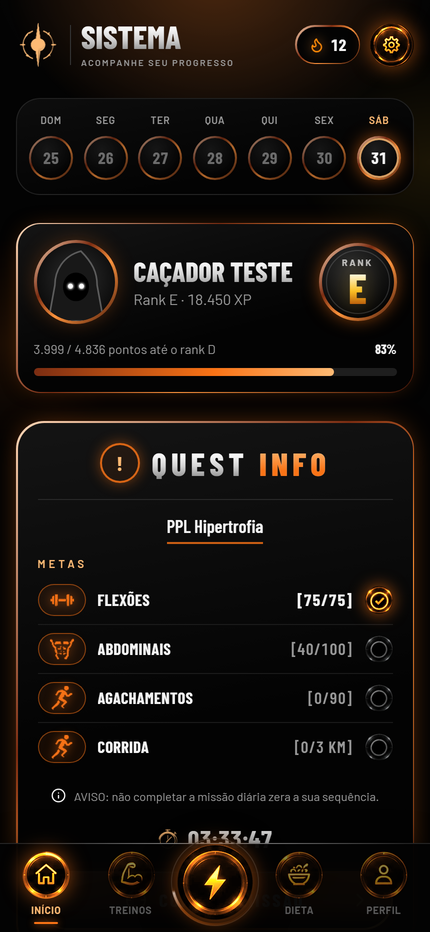
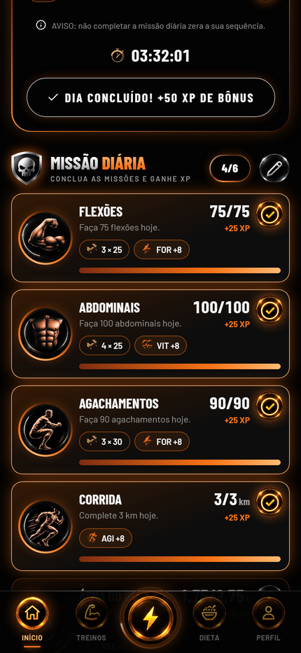
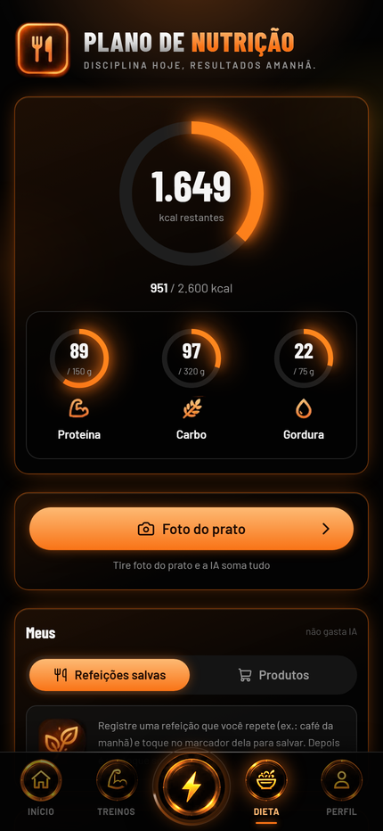
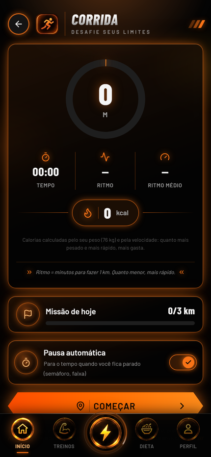

# Sistema

App de treino e dieta inspirado em Solo Leveling: você vira um "caçador", cumpre as missões do dia e sobe de nível e de rank na vida real. Funciona no navegador do celular e pode ser instalado na tela inicial (PWA).

O código é privado. Este repositório apresenta o produto. As telas usam dados de demonstração.

<table>
  <tr>
    <td></td>
    <td></td>
    <td></td>
  </tr>
  <tr>
    <td></td>
    <td></td>
    <td></td>
  </tr>
</table>

## O que ele faz

- **Missões diárias:** o treino do dia vira missões, com XP, atributos e sequência de dias.
- **Progressão semanal:** a meta sobe 10% por semana. Com o botão "Não consegui", passa a subir de 1 em 1. Faltar um dia só zera a sequência.
- **Treinos:** biblioteca de treinos prontos e opção de montar o próprio.
- **Câmera:** conta as repetições pelo movimento do corpo, de frente ou de lado.
- **Corrida:** GPS com distância, tempo, ritmo e calorias.
- **Dieta:** calorias, proteína, carbo, gordura e água, com busca de alimentos, código de barras e foto do prato com IA.
- **Ligas e troféus:** ranking semanal com subida e descida de liga, além de conquistas em 5 níveis.
- **Card de treino:** imagem pronta para salvar ou compartilhar quando termina o dia.
- **Lembretes:** notificação diária se as missões não estiverem completas.

## Status

O app está no ar, com uma exceção: o **Premium** ainda não tem pagamento. A tela e os planos existem, mas o botão de assinar só mostra um aviso, e a liberação é manual pelo painel admin.

## Stack

React, TypeScript e Vite no app. Supabase no banco, login e funções. MediaPipe na contagem por câmera. Publicado no Netlify.

## Licença

Todos os direitos reservados © Gabriel Serra da Rosa.
